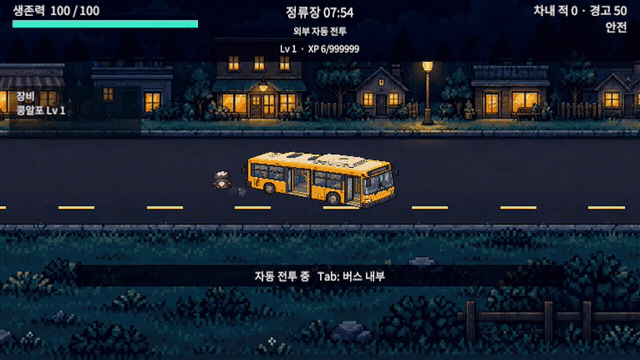

# LAST STOP

달리는 버스를 지키는 **Unity 6 기반 2D 픽셀 아트 생존 로그라이크 프로토타입**입니다. 외부에서는 버스 장비가 적을 자동 공격하고, 내부에서는 플레이어가 직접 방망이를 휘둘러 코어를 지킵니다.

## 플레이 영상 / 프로젝트 확인

버스 접촉, 내부 전환, 방망이 반격을 담은 프로젝트 플레이 미리보기입니다. 저장소에 기록된 영상이며, 본 문서 보완 작업에서는 Unity 에디터를 별도로 실행해 검증하지 않았습니다.

[게임 소리가 포함된 MP4 보기](Docs/Media/last-stop-preview.mp4?raw=true)

## 실행 방법

1. 이 저장소를 내려받고 Unity Hub에서 프로젝트 폴더를 추가합니다.
2. **Unity 6000.3.15f1**에서 프로젝트를 열고 에셋 임포트가 끝날 때까지 기다립니다.
3. `Assets/Scenes/SampleScene.unity`를 열고 Play를 누릅니다.

| 키 | 동작 |
| --- | --- |
| Tab | 버스 외부/내부 화면 전환 |
| A / D 또는 ← / → | 버스 내부 좌우 이동 |
| Space | 방망이 공격(누르고 있으면 연속 공격) |
| 1 / 2 / 3 또는 마우스 | 레벨업 카드 선택 |
| R | 게임 종료 후 재시작 |

## 핵심 게임 루프

- 외부의 버스 장비는 자동으로 공격합니다. 적이 버스에 닿으면 한 마리씩 내부로 진입합니다.
- 실내 전투를 조작하는 동안에도 실외 전투 시뮬레이션은 계속됩니다.
- 플레이어와 코어는 **생존 HP 하나를 공유**합니다. 실제 피격이 발생할 때에만 HP가 감소합니다.
- 내부 적 50마리는 **경고 기준**이며 즉시 패배 조건이 아닙니다.
- 레벨업 카드로 장비를 강화하고 **8분**을 버텨 다음 정류장에 도달하는 것이 데모 목표입니다.

## AI 협업 방식과 책임 범위

이 프로젝트는 사람이 최종 게임 규칙과 작업 범위를 결정하고, Codex 기반 AI 에이전트를 **기획·개발·아트·사운드·UI** 역할로 나누어 작업하도록 구성했습니다. 이는 실제 인력 5개 팀을 관리했다는 뜻이 아닙니다.

- **사람(기획·승인 책임):** 핵심 콘셉트, 데모 목표, 게임 규칙의 최종 승인, 변경 범위 결정 및 최종 검증
- **AI 도구(작업 보조):** 규칙·작업 지침을 바탕으로 코드/문서/에셋의 초안 작성·보완 지원
- **검토 기준:** 변경 파일·가정·테스트 결과·미해결 항목을 명시하고, 확인 없이 완료로 표시하지 않음
- **작업 원칙:** 씬/프리팹/메타파일 소유권 충돌 방지, 승인 없는 게임 규칙 확정 금지, 작은 단위의 검토 가능한 변경

자세한 역할 분리 기준은 [AGENTS.md](AGENTS.md), [프로듀서 가이드](Docs/Manager.md)에서 볼 수 있습니다.

## 기획·검증 자료

- [게임 규칙 기준선](Docs/GameDesign.md)
- [작업 진행 및 테스트 체크리스트](Docs/Tasks.md)
- [AI 에이전트 공통 지침](AGENTS.md)

**구현 상태 안내:** 프로토타입과 플레이 미리보기 파일은 저장소에 존재하지만, 이 문서 정리 시점의 별도 환경에서 Unity 실행·빌드·전체 테스트 완료를 확인한 것은 아닙니다. 지원 포트폴리오에서도 '프로토타입 제작'과 '검증 완료'를 구분합니다.

기술: Unity 6 / URP 2D / C# / Unity Input System.
Noto Sans CJK KR 사용 관련 라이선스는 [동봉한 라이선스](Assets/Resources/Fonts/NotoSansCJKkr-LICENSE.txt)를 참고해 주세요.
